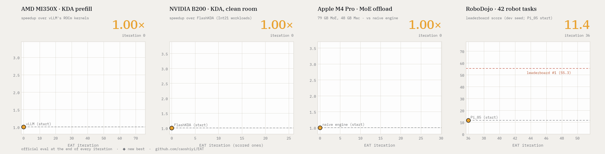
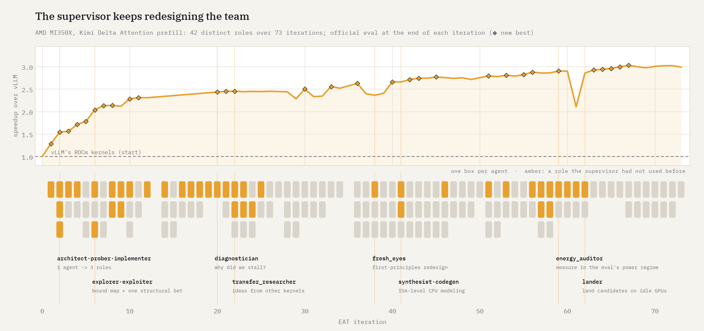
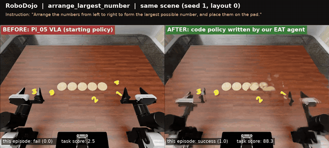
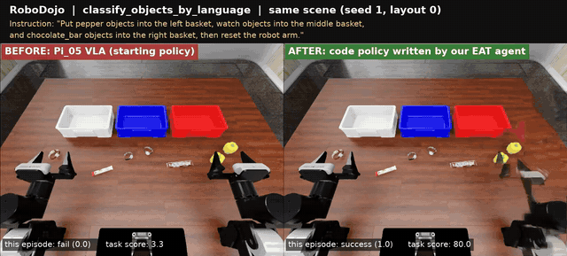

<p align="center">
  <picture>
    <source media="(prefers-color-scheme: dark)" srcset="assets/eat_lockup_dark.png">
    
  </picture>
</p>

<h3 align="center">Evolving Agent Teams</h3>
<p align="center"><em>Agents that diagnose why they stall and restructure their own team</em></p>

<p align="center">
  <a href="https://arxiv.org/abs/2610.36848"></a>
  <a href="https://huggingface.co/datasets/eva98/eat-gym"></a>
  <a href="https://huggingface.co/datasets/eva98/eat-evolution-traces"></a>
  <a href="https://github.com/caoshiyi/eat-kernels"></a>
  <a href="LICENSE"></a>
</p>

<p align="center"></p>

<table align="center">
<tr>
<td align="center" width="25%"><h1>3.01×</h1><b>AMD MI350X</b><br><sub>Kimi Delta Attention prefill<br>over vLLM's ROCm kernels</sub></td>
<td align="center" width="25%"><h1>2.42×</h1><b>NVIDIA B200</b><br><sub>KDA serving kernel over FlashKDA<br>clean room: no web</sub></td>
<td align="center" width="25%"><h1>3.32×</h1><b>Apple M4 Pro, 48 GB</b><br><sub>79 GB MoE served from SSD<br>over the naive engine</sub></td>
<td align="center" width="25%"><h1>62.1</h1><b>RoboDojo, 42 tasks</b><br><sub>held-out score; leaderboard #1: 55.3<br>start (Pi_05): 11.4</sub></td>
</tr>
</table>

<p align="center"><b>One supervisor agent. No hand-written solution.</b> It designs a team of coding agents, watches it work,
diagnoses why it stalls, and rebuilds the team, for as long as the budget lasts.</p>

## Get started

In Claude Code, install EAT once:

```
/plugin install eat --marketplace caoshiyi/EAT
```

Then, in the repository you want to improve, just ask:

> *Use EAT to make `bench.py` faster on GPUs 0 and 1. Budget $200.*
>
> *Run the EAT Gym task `amd_kda_mi350x` on GPUs 0-3 with a $300 budget.*

Claude checks the machine, writes the task's eval and rules with you, records the starting score and launches the run;
later ask it how the run is going, or to pause, stop or resume it. **Nothing installed?** Tell Claude Code *"Use EAT
(github.com/caoshiyi/EAT) to ..."* and it fetches the skill itself.

## The supervisor invents the team that breaks the plateau

The supervisor never touches the solution. When the score stalls, it reads the team's transcripts, names what is
holding it back, and **creates the role that attacks it**. Over the 73 iterations of the MI350X run it used 42
distinct roles, from a single `solo_optimizer` to an `energy_auditor` and a `lander`:

<p align="center"></p>

**How the B200 run went past the best published kernel in four iterations.** Each row is one iteration: the
supervisor's diagnosis of the previous team (quoted from its `EVOLUTION_HISTORY.md`), the team it built in response,
and the official score that team reached.

| iter | the supervisor's diagnosis of the previous team | team it designed | score |
|:-:|---|---|:-:|
| 1 | | `solo_optimizer` | 2.19× |
| 2 | *"Plateau cause = team structure: one agent, anchored on an inherited 2.5k-line generated kernel, so every idea was a patch to its fixed decomposition."* | `architect` · `incumbent_optimizer` · `hw_analyst` | 2.34× |
| 3 | *"The dynamic instruction count is the unattacked term: no role does SASS-level accounting."* Also: *"Early stopping is a repeat pattern."* | `integrator` · **`issue_economist`** (new) · `analyst`, plus a no-early-stop rule | **2.94×** |
| 4 | *"A classic local optimum of the fused CAKE structure ... Nobody re-examined the fused-kernel structure itself."* | `integrator` · **`architect`** (must first diagnose why the iteration-2 design missed by 3×) · `analyst` | **3.14×**, past the best published result (2.95×, on B300) |
| 5 | *"The largest measured slack is the prep work per token (work pass, Akk); no role owns reducing it."* | `integrator` · **`prep_architect`** · **`robustness_analyst`** | 3.24× |

The same pattern appears late in long runs. In the MI350X run, iterations 57 and 58 shipped nothing; the
supervisor found that the team had been timing its ideas in a different regime from the eval, and wrote a new role
for iteration 59:

> **ENERGY AUDITOR.** *"The pattern runs on a power transient: device time is 1.08–1.29× the gapped time ... The team
> has therefore been pricing levers in a regime the score does not use. Your job is to fix the measurement and re-open
> what it may have mis-judged."*

That iteration set a new best (2.90×), and the run went on to 3.03×. Every team config, prompt and transcript is in
the [traces](https://huggingface.co/datasets/eva98/eat-evolution-traces).

## Demo: a robot policy written by agents

The starting policy is the Pi_05 VLA. The EAT team replaced it with Python code that calls the frozen Pi_05 and, at
runtime, Claude, and raised RoboDojo's leaderboard score from 11.4 to **62.1 on held-out seeds, above every entry on
the leaderboard (55.3, Oct 26, 2026)**. Same scene, left: Pi_05; right: the team's code policy.

<p align="center"></p>
<p align="center"><sub><code>make_kong</code> (Mahjong): task score 16.7 → 97.2. <a href="assets/robodojo_make_kong.mp4">Full video</a></sub></p>

<table>
<tr>
<td width="50%"></td>
<td width="50%"></td>
</tr>
<tr>
<td align="center"><sub><code>arrange_largest_number</code>: task score 2.5 → 88.3</sub></td>
<td align="center"><sub><code>classify_objects_by_language</code>: task score 3.3 → 80.0</sub></td>
</tr>
</table>

## Results

| task | hardware | start | EAT |
|---|---|---|---|
| Kimi Delta Attention prefill | AMD MI350X | vLLM ROCm KDA kernels | **3.01×** mean speedup (independently verified) |
| Kimi Delta Attention prefill, **clean room** | NVIDIA B200 | FlashKDA | **2.42×** on 26 serving workloads, **3.35×** on Int21 (production kernel); 3.48× Int21 in the harness |
| MoE expert offload: Qwen3.8-Flash-Next, 79 GB, MLX 4-bit | Apple M4 Pro, 48 GB | naive offload engine | **3.32×** faster on recorded coding-agent sessions; batch-1 decode 13.4 → 30.3 tokens/s (with a second run) |
| RoboDojo code policy, 42 tasks | 4-8 AWS g6e (L40S) | Pi_05 (11.44) | **62.08** on held-out seeds (leaderboard #1: 55.3) |

Kernel speedups are geomeans from each task's official eval, with correctness as a hard gate. The B200 run was a clean
room: no network beyond the model API, and no KDA kernel newer than its FlashInfer starting snapshot.

<p align="center"></p>
<p align="center"><sub>Score at the end of each iteration, from the paper (Figure 7). (a) MI350X, from a port of vLLM's
kernels. (b) B200, from a port of FlashInfer's KDA kernels. (c) MoE offload from the naive engine; star: final engine on
the recorded sessions. (d) RoboDojo: dev (seed 1) and held-out (seeds 0, 2) scores, with leaderboard references as of
Oct 26, 2026.</sub></p>

**Everything is released.** The kernels, packaged for inference engines (vLLM-style serving interface with paged state
and prefix-cache checkpoints): [eat-kernels](https://github.com/caoshiyi/eat-kernels). Every supervisor and agent
transcript, team config, note and per-iteration kernel or policy:
[eva98/eat-evolution-traces](https://huggingface.co/datasets/eva98/eat-evolution-traces). The tasks, at the state each
run started from: [EAT Gym](https://huggingface.co/datasets/eva98/eat-gym).

## How it works

EAT is a harness in which a **supervisor** agent repeatedly designs, launches and revises a **team** of coding agents
(Claude Code) that optimize a GPU kernel (or another program, such as a robot policy) against a fixed eval. The
supervisor never writes the solution; its only output each iteration is a team configuration (roles, prompts, phases,
ownership of files and GPUs). The team does the work, the harness runs the official eval, and the supervisor reflects
on the result and evolves the team. A file system kept across all teams (learnings, evolution history, artifacts)
grounds each redesign in what earlier teams found.

<p align="center"></p>

```
while budget remains:
    supervisor:  REFLECT on the previous team's output -> EVOLVE roles / prompts / workflow -> emit TEAM_CONFIG
    harness:     launch the team's agents phase by phase -> run the official eval -> record cost and score
```

## Clean-room runs

To show that a result was not copied from code released after a cutoff, run the whole loop inside the
[bubblewrap](https://github.com/containers/bubblewrap) sandbox, from the task repository:

```bash
EAT_CLEAN=/path/to/sandbox-state EAT_ALLOWED_RO="/refs/cutlass /refs/flashinfer-2026-08-13" EAT_GPUS="0 1" \
CLAUDE_EXTRA_DISALLOWED=WebSearch,WebFetch $EAT_HOME/cleanroom/sandbox.sh \
    bash $EAT_HOME/agent_team/launch_stateless.sh --persistent 50 3 300
```

Only the task repository, EAT, and the `EAT_ALLOWED_RO` sources are visible, and the network reaches only the
Anthropic API (through `allowlist_proxy.py`, which logs every request). Afterwards,
`cleanroom/audit_clean_traces.py` scans every tool call in the run's transcripts for web use, network commands and
forbidden sources, and `cleanroom/audit_code_overlap.py` finds code lines that appear only in the forbidden sources.

## For coding agents

If a user asks you to use EAT and the `eat` skill is not installed: clone this repository (for example to
`~/.claude/skills/eat`) and follow [`SKILL.md`](SKILL.md), with `EAT_HOME` set to the clone.

## Citation

```bibtex
@inproceedings{cao2026eat,
  title     = {Evolving Agent Teams},
  author    = {Cao, Shiyi and Mao, Ziming and Li, Dacheng and Gonzalez, Joseph E. and Stoica, Ion},
  booktitle = {Advances in Neural Information Processing Systems (NeurIPS)},
  year      = {2026},
  url       = {https://arxiv.org/abs/2610.36848}
}
```

## License

Apache-2.0. Tasks installed from the EAT Gym bring their own NOTICE for the third-party code they contain.
