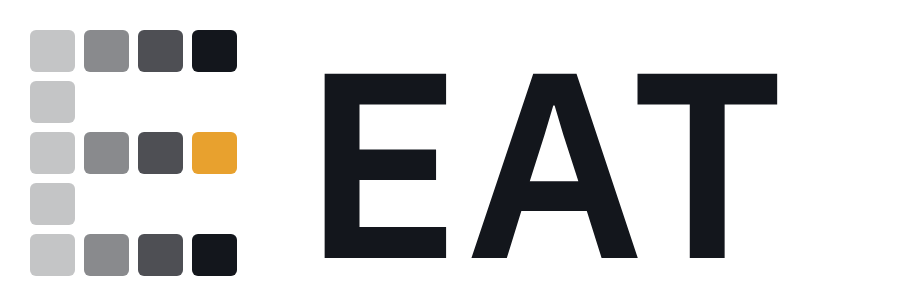
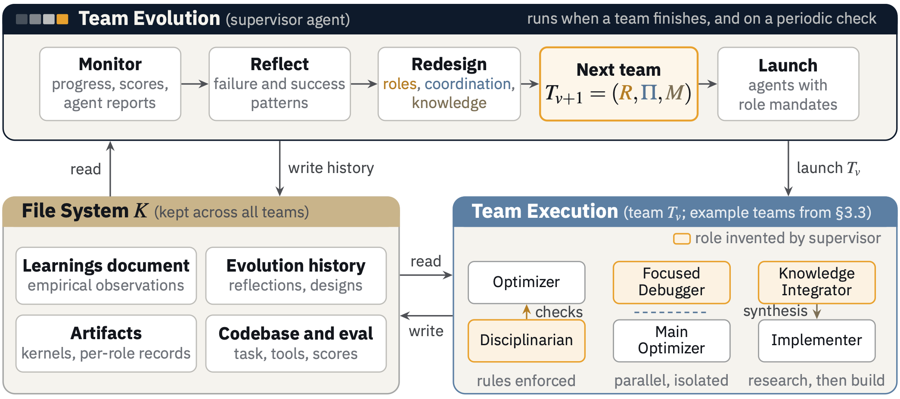
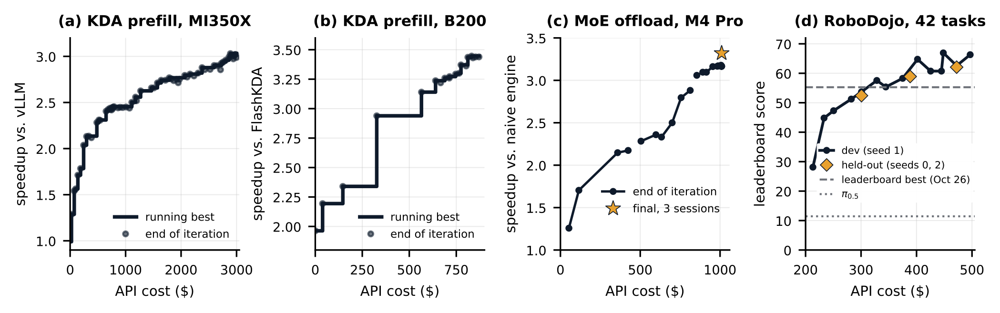
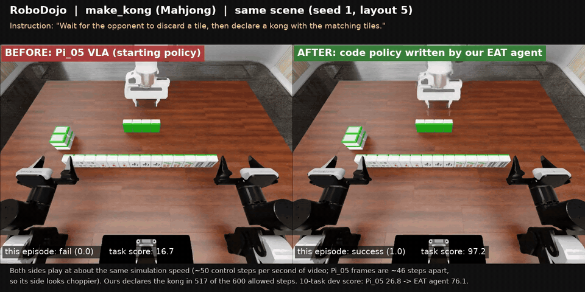

<p align="center">
  <picture>
    <source media="(prefers-color-scheme: dark)" srcset="assets/eat_lockup_dark.png">
    
  </picture>
</p>

<h3 align="center">Evolving Agent Teams</h3>
<p align="center"><em>Agents that diagnose why they stall and restructure their own team</em></p>

<p align="center">
  <a href="https://arxiv.org/abs/2610.36848"></a>
  <a href="https://huggingface.co/datasets/eva98/eat-gym"></a>
  <a href="https://huggingface.co/datasets/eva98/eat-evolution-traces"></a>
  <a href="https://github.com/caoshiyi/eat-kernels"></a>
  <a href="LICENSE"></a>
</p>

EAT is a harness in which a **supervisor** agent repeatedly designs, launches and revises a **team** of coding agents
(Claude Code) that optimize a GPU kernel (or another program, such as a robot policy) against a fixed eval. The
supervisor never writes the solution; its only output each iteration is a team configuration (roles, prompts, phases,
ownership of files and GPUs). The team does the work, the harness runs the official eval, and the supervisor reflects
on the result and evolves the team. A file system kept across all teams (learnings, evolution history, artifacts)
grounds each redesign in what earlier teams found.

<p align="center"></p>

```
while budget remains:
    supervisor:  REFLECT on the previous team's output -> EVOLVE roles / prompts / workflow -> emit TEAM_CONFIG
    harness:     launch the team's agents phase by phase -> run the official eval -> record cost and score
```

## Layout

```
agent_team/
  launch_stateless.sh    supervisor loop (persistent or stateless supervisor sessions), budget accounting
  launch_team.sh         runs one team: parses TEAM_CONFIG, launches agents per phase, official eval, TEAM_OUTPUT.md
  parse_team_config.py   TEAM_CONFIG -> per-role prompt files and a phase plan
  extract_result.py      final text of a `claude --print --output-format json` run
  SUPERVISOR.md          the supervisor's instructions (how to reflect and evolve, not how to optimize kernels)
ops/
  env.sh                 node settings (paths, task, GPUs) used by the scripts below
  fetch_task.sh          install a task from the EAT Gym into this checkout
  pick_eval_gpu.sh       pick an idle GPU from $EAT_GPUS for the official eval (ROCm or NVIDIA)
  gpu_run                run a command on an NVIDIA GPU nobody else uses; preempts itself if someone arrives
  curve_data.py          export per-iteration cost / score / team / ships as JSON
  verify_iter.py         re-run an iteration's committed kernel independently (3 evals + optional extra check)
  curve_loop.sh          export the curve every 5 min and verify each new best automatically
cleanroom/
  sandbox.sh             bubblewrap sandbox: only listed sources visible, network only to the Anthropic API
  allowlist_proxy.py     HTTPS CONNECT proxy that only passes the allowlisted hosts (logs every request)
  tcp2unix.py            bridge from the sandbox's loopback to the proxy socket
  audit_clean_traces.py  scan every tool call in a run's transcripts for web use, network, forbidden sources
  audit_code_overlap.py  line-level overlap of the candidate code with allowed vs forbidden sources
  audit_after_iter.sh    run both audits after iteration N completes
```

## Tasks

Tasks are kept apart from the harness, in the EAT Gym: the Hugging Face dataset
[eva98/eat-gym](https://huggingface.co/datasets/eva98/eat-gym), in the [Harbor](https://harborframework.com) task
format (instruction, pinned environment, verifier), so the same tasks also run with any Harbor agent. Each task is
stored at the state an EAT run started from; the dataset README lists them.

`bash ops/fetch_task.sh <task> --setup` installs one into the checkout and sets up its environment (venv with
pinned libraries, reference repositories at pinned commits, baselines; listed in the task's `environment/README.md`):

```
tasks/<task>/                    task spec (program.md), starting code, reference, baselines, refs.txt, fetch_refs.sh
tools/eval_<task>.*              the task's official eval
agent_team/requirements/<task>.md hard rules the supervisor must put into every agent prompt (environment, files, GPUs)
```

and adds the task's row and rules to `CLAUDE.md`. A new task is a directory of the same shape; see the dataset README.

## Running a task

Requirements: Linux, Claude Code (`claude`) logged in or `CLAUDE_CODE_OAUTH_TOKEN` set, git, tmux, the Hugging Face
CLI (`pip install -U huggingface_hub`), `uv`, and the task's hardware and system toolchain
(see the task's `environment/README.md`, or use its `environment/Dockerfile`).

```bash
export EAT_GPUS="0 1"                # GPUs the run may use
export EAT_TASK=<task>               # a task of the EAT Gym
source ops/env.sh                    # defaults: work dir .work/, refs .work/refs, venv .work/venv
bash ops/fetch_task.sh $EAT_TASK --setup  # install the task, its venv, reference repos and baselines; prints its eval command
git checkout -b $EAT_TASK/run1       # the team commits its progress here
export EVAL_CMD='source $EAT_VENV/bin/activate && python tools/eval_<task>.py'   # the printed eval command, plus
                                     # e.g. the GPU to use (ops/pick_eval_gpu.sh)
tmux new-session -d -s ${EAT_SESSION}1 \
  "bash agent_team/launch_stateless.sh --persistent $EAT_TASK 80 3 3000 1 2>&1 | tee -a $EAT_LOG"
```

Arguments: mode, task, max iterations, max team size, budget in dollars, first iteration. Each iteration leaves
`agent_team/iter_<n>/` (team config, every agent's prompt and output, the official eval) and a commit
`iter <n>: task=... cost=... score=...`; `agent_team/BUDGET.md` accumulates cost and score.
Agents run with `--dangerously-skip-permissions`: run on a machine (or in `cleanroom/sandbox.sh`) where that is acceptable.

Optional settings (environment variables of `launch_stateless.sh`):

| variable | effect |
|---|---|
| `SUPERVISOR_MODEL` | model of the supervisor session (default: the CLI default) |
| `AGENT_MODELS` | comma-separated models a role may pick with a `**Model:**` line in the team config; roles without one use the default model |
| `SUPERVISOR_REFRESH_COST` | persistent mode: after a supervisor turn (with its retries) that cost more than this many dollars, the next iteration starts a new supervisor session with a handover note telling it to read the record and reassess the team design (default: off) |
| `EAT_PAUSE_FILE` | wait before each iteration while this file exists (e.g. while you run a held-out eval) |
| `CLAUDE_EXTRA_DISALLOWED` | extra tools to disable for every session (`WebSearch,WebFetch` for clean-room runs) |

An agent that hits its `**Timeout:**` is stopped and resumed once for a final report (so its findings and its cost
are recorded), and background processes it left running are stopped. A resumed persistent supervisor session is
booked only for the cost added since it was last booked.

### Clean-room runs

To show that a result was not copied from code released after a cutoff, run the whole loop inside
`cleanroom/sandbox.sh` with only pre-cutoff sources mounted (`EAT_ALLOWED_RO`), web tools disabled
(`CLAUDE_EXTRA_DISALLOWED=WebSearch,WebFetch`) and network limited to the Anthropic API by the proxy; then audit
the transcripts and the produced code with `cleanroom/audit_*.py`.

## Results

<p align="center"></p>
<p align="center"><sub>Harness score at the end of each iteration. (a) MI350X, from a port of vLLM's kernels. (b) B200,
from a port of FlashInfer's KDA kernels. (c) MoE offload from the naive engine; star: final engine on the recorded
sessions. (d) RoboDojo, 42 tasks: dev (seed 1) and held-out (seeds 0, 2) scores, with leaderboard references as of
Oct 26, 2026. (Figure 7 of the paper.)</sub></p>

| task | hardware | baseline | result | iterations |
|---|---|---|---|---|
| `amd_kda_mi350x`: Kimi Delta Attention prefill | AMD MI350X | vLLM ROCm KDA kernels | 3.01x mean speedup (independently verified; harness 2.99-3.03x) | 73 |
| `b200_kda_clean`: Kimi Delta Attention prefill, clean room | NVIDIA B200 | FlashKDA | 2.42x on the serving set, 3.35x on the Int21 workloads (geomean) | 26 + 16 |
| `ftm_qwen4_offload`: MoE expert-offload serving (Qwen3.8-Flash-Next, MLX 4-bit, 79 GB) | Apple M4 Pro, 48 GB | naive offload engine | TBD | TBD |
| `robodojo_codepolicy`: RoboDojo code policy (10 tasks, all 42 from iteration 37) | 4-8 AWS g6e (L40S) | Pi_05 on every task (11.44 on the leaderboard) | 62.08 on held-out seeds 0 / 2, all 42 tasks, leaderboard formula (leaderboard best on Oct 26, 2026: 55.3) | 51 |

Kernel speedups are geomeans from each task's official eval; correctness is a hard gate. `b200_kda_clean` ran in the
clean room (no network, no KDA kernels newer than its FlashInfer starting snapshot).

The KDA kernels are released in [eat-kernels](https://github.com/caoshiyi/eat-kernels), packaged for inference
engines (`kda/mi350x`, `kda/b200`: vLLM-style serving interface with paged state and prefix-cache checkpoints;
`_plain` variants for plain calls). The full evolution traces (every supervisor and agent transcript, team configs,
notes, per-iteration kernels and policies) are in the Hugging Face dataset
[eva98/eat-evolution-traces](https://huggingface.co/datasets/eva98/eat-evolution-traces) (`amd_kda_mi350x/`,
`b200_kda_clean/`, `robodojo_codepolicy/`).

### RoboDojo demo

The team's policy is Python code that calls the frozen Pi_05 VLA and, at runtime, Claude. Below, the same
`make_kong` (Mahjong) scene with the starting Pi_05 policy (left, task score 16.7) and the evolved code policy
(right, 97.2). [Full video](assets/robodojo_make_kong.mp4).

<p align="center"></p>

## Citation

```bibtex
@inproceedings{cao2026eat,
  title     = {Evolving Agent Teams},
  author    = {Cao, Shiyi and Mao, Ziming and Li, Dacheng and Gonzalez, Joseph E. and Stoica, Ion},
  booktitle = {Advances in Neural Information Processing Systems (NeurIPS)},
  year      = {2026},
  url       = {https://arxiv.org/abs/2610.36848}
}
```

## License

Apache-2.0. Tasks installed from the EAT Gym bring their own NOTICE for the third-party code they contain.
